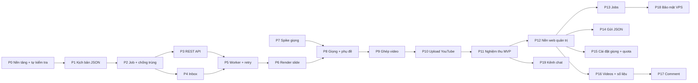

# DocReel — Kế hoạch code

> Bám theo `SPEC.md`. Chia **phase nhỏ theo use case**: mỗi phase xong là chạy được, có test, có lệnh tự kiểm tra trả về đạt/không đạt.
> Giai đoạn A = MVP (bản 1). Giai đoạn B = bản 2 (trang quản trị, kênh chat).

---

## 0. Cách làm mỗi phase

1. Viết **test trước** cho logic (validator, state machine, chọn provider, tính offset video…), rồi code cho test qua.
2. Code chỉ trong package của feature đó; luật phụ thuộc do ArchUnit giữ (mục 2.1).
3. Chạy **lệnh tự kiểm tra** của phase → phải xanh.
4. Chạy `scripts/check.ps1` (toàn bộ) → phải xanh. Không xanh thì chưa xong.
5. Cập nhật `SPEC.md` nếu có quyết định mới, đánh ✅ story tương ứng.

**Definition of Done chung**
- [ ] Unit test cho mọi nhánh logic mới (gồm case lỗi), JaCoCo không giảm dưới ngưỡng.
- [ ] Ít nhất 1 integration test cho mỗi đường đi qua DB / HTTP / file / process ngoài.
- [ ] `scripts/check.ps1` xanh.
- [ ] Log có `jobId` (MDC) ở mọi dòng liên quan job.
- [ ] Không có secret trong code / log.

---

## 1. Tổng quan phase



| Phase | Use case | Story SPEC | Ai viết | Lệnh tự kiểm tra |
|---|---|---|---|---|
| **A — MVP** | | | | |
| P0 | (nền tảng) | 1 | AI | `scripts/check.ps1` |
| P1 | UC2 (phần kiểm tra kịch bản) | 2 | **Tôi** | `./mvnw test -Dtest='Script*'` + `npm test` |
| P2 | UC5, trạng thái job | 3 | **Tôi** | `./mvnw verify -Dit.test='Job*IT'` |
| P3 | UC2, UC3, UC4 | 4 | **Tôi** | `./mvnw verify -Dit.test='JobController*'` |
| P4 | UC1 (nhận file) | 5 | AI | `./mvnw verify -Dit.test='Inbox*IT'` |
| P5 | UC1 (điều phối), UC4 | 6 | **Tôi** | `./mvnw verify -Dit.test='Pipeline*IT'` |
| P6 | UC1 (render) | 8 | AI | `./mvnw verify -Pmedia -Dit.test='TemplateGallery*'` |
| P7 | (spike) | 9 | **Tôi** | checklist |
| P8 | UC1 (giọng), UC6 | 10, 11 | AI | `./mvnw verify -Dit.test='Tts*IT'` |
| P9 | UC1 (video) | 12 | AI | `./mvnw verify -Pmedia -Dit.test='VideoAssembler*'` |
| P10 | UC1 (upload) | 13 | AI | `./mvnw verify -Dit.test='YouTube*IT'` |
| P11 | UC1 → UC5 end-to-end | 14, 15 | **Tôi** | `scripts/check.ps1 -E2E` + `--doctor` |
| **B — Bản 2** | | | | |
| P12 | (nền web quản trị) | W1 | AI | `scripts/check.ps1` + `AdminSpaIT` |
| P13 | UC3, UC4 qua web | W2 | AI | `npm test -- jobs` + `JobQueryIT` |
| P14 | UC2 qua web | W3 | AI | `npm test -- submit` + contract test |
| P15 | UC10, UC11 | W4, W5 | **Tôi** (backend) + AI (web) | `TtsSettings*` + `npm test -- settings` |
| P16 | UC8 | W6 | AI | `VideoStatsSync*` + `npm test -- videos` |
| P17 | UC9 | W7 | AI | `VideoComment*` |
| P18 | (bảo mật) | W8 | AI | `SecurityIT` |
| P19 | UC7 | B1–B4 | AI | `Telegram*IT` |

---

## 2. Cơ chế tự kiểm tra (làm ở P0, dùng suốt dự án)

### 2.1 Lớp tĩnh
- `maven-compiler-plugin`: `-Xlint:all -Werror`.
- **Spotless** (palantir-java-format) — `spotless:check` trong `verify`.
- **ArchUnit** (`ArchitectureTest`):
  - Feature package (`job`, `pipeline`, `script`, `render`, `voice`, `video`, `youtube`, `ingest`, `notify`, `settings`, `stats`) **không vòng phụ thuộc**.
  - `*Controller` chỉ gọi `*Service`, không gọi `*Repository`.
  - `pipeline` không phụ thuộc `web`/controller; `script` không phụ thuộc gì ngoài `common`.
  - Không gọi `ProcessBuilder` ngoài `common.ProcessRunner`.
  - Không dùng `System.out` / `printStackTrace`.
- `web/`: `npm run lint`, `npm run typecheck`.

### 2.2 Unit + coverage
- JUnit 5 + AssertJ + Mockito; Vitest cho `web/`.
- **JaCoCo**: `verify` fail nếu line coverage < **80%** cho `script`, `job`, `pipeline`, `voice`, `settings` (các package khác ≥ 60%).
- Test đặt tên theo hành vi: `rejectsQuizWhenAnswerOutOfRange()`.

### 2.3 Integration
- **Testcontainers** Postgres 16 (dùng lại container giữa các test bằng `@ServiceConnection` + reuse).
- **WireMock** giả ElevenLabs, YouTube (file stub trong `src/test/resources/wiremock/`); **script giả** thay CLI `edge-tts` (`src/test/resources/fake-edge-tts/`: ghi mp3 mẫu, hoặc thoát mã lỗi theo biến môi trường).
- Test cần ffmpeg / Chromium gắn `@Tag("media")`, chạy bằng `-Pmedia` (máy dev có sẵn); CI chạy luôn vì cài sẵn trong image.

### 2.4 Contract (Java ↔ TypeScript dùng chung mẫu)
```
samples/
├── scenes/*.ok.json, *.overflow.json      (đã có)
├── full/*.json                            (đã có)
└── invalid/
    ├── quiz-answer-out-of-range.json
    ├── first-scene-not-title.json
    ├── duplicate-scene-id.json
    ├── code-too-many-lines.json
    ├── unknown-field.json
    ├── … (≥ 15 case)
    └── expected.json        { "quiz-answer-out-of-range.json": ["scenes[8].answer"], … }
```
- `ScriptContractTest` (Java): mọi file trong `full/` hợp lệ; mọi file trong `invalid/` sinh **đúng** danh sách đường dẫn lỗi trong `expected.json`.
- `script.contract.test.ts` (web, P14): validator phía web cho cùng kết quả → web báo lỗi giống server.

### 2.5 E2E tự động (profile `e2e`)
- `FakeTtsProvider`: sinh audio im lặng dài `số ký tự × 60ms` (biết trước thời lượng), không tốn quota.
- `FakeYouTubeUploader`: ghi file vào `work/uploaded/`, trả id giả.
- `EndToEndIT`: thả `samples/full/sample-all-scenes.json` vào inbox tạm → chờ `UPLOADED` (timeout 5 phút) → kiểm:
  - MP4 tồn tại, 1080×1920, có audio + video.
  - `ffprobe` thời lượng = tổng audio các scene (± 1 frame).
  - Mốc bắt đầu mỗi slide = tổng audio các scene trước (± 1 frame) — đo bằng `select=gt(scene\,0.3)` của ffmpeg.
  - Có đủ số dòng `.srt`, không dòng nào vượt quá cuối video.
  - Thả lại cùng file → `duplicate/`, không job mới.

### 2.6 Tự kiểm tra lúc chạy
- `SystemSelfCheck` chạy lúc khởi động + mỗi 15 phút, mỗi mục có mức `CRITICAL` / `WARN`:

| Mục | Kiểm | Mức |
|---|---|---|
| ffmpeg, ffprobe | chạy `-version`, đúng bản tối thiểu | CRITICAL |
| edge-tts | `edge-tts --list-voices` chạy được + có giọng `vi-VN` đang cấu hình | WARN (ElevenLabs cũng không dùng được: CRITICAL) |
| Chromium (Playwright) | mở trang trống | CRITICAL |
| Thư mục | `inbox/ work/ done/ failed/ duplicate/` tồn tại + ghi được | CRITICAL |
| Ổ trống | ≥ 2 GB ở ổ chứa `work/` | WARN (< 500 MB: CRITICAL) |
| DB | Flyway đã migrate, kết nối được | CRITICAL |
| TTS | ElevenLabs có key + quota còn lại (gọi `/v1/user/subscription`) | WARN |
| YouTube | refresh token còn hạn | WARN |
| Template | render 1 mẫu `ok` → `data-problems` rỗng | WARN |

- Có mục CRITICAL lỗi → `PipelineWorker` **tạm dừng** (không claim job), health `DOWN`, log rõ cách sửa.
- Xem: `GET /actuator/health` (gộp vào health indicator), `GET /api/system/check` (chi tiết), web hiện thẻ trạng thái (P12).
- `java -jar docreel.jar --doctor`: chạy toàn bộ kiểm tra, in bảng, thoát mã `0` / `1` — dùng sau khi cài máy mới hoặc trước khi lên VPS.

### 2.7 Một lệnh cho tất cả
`scripts/check.ps1` (và `scripts/check.sh`):
```
1. ./mvnw -q spotless:check
2. ./mvnw verify                 # compile -Werror, ArchUnit, unit, integration, contract, JaCoCo
3. cd web; npm run lint; npm run typecheck; npm test; npm run build
4. (-Media) ./mvnw verify -Pmedia
5. (-E2E)   ./mvnw verify -Pe2e
→ in bảng tổng kết từng bước ĐẠT / KHÔNG ĐẠT, thoát mã 1 nếu có bước hỏng
```
- Git hook `pre-push` gọi `scripts/check.ps1`.
- Nếu đẩy lên GitHub: workflow CI chạy cùng script (Ubuntu, có ffmpeg + Chromium).

---

## 3. Giai đoạn A — MVP

### P0 · Nền tảng + cơ chế tự kiểm tra · story 1 · AI
**Kết quả:** project Spring Boot 4 (Java 21, Maven wrapper) chạy được, có DB, có đủ bộ kiểm tra ở mục 2 (trừ E2E).
- `pom.xml`: web, data-jpa, validation, actuator, thymeleaf, flyway, postgresql, testcontainers, archunit, wiremock, jacoco, spotless.
- `compose.yaml` Postgres 16; `application.yml` + `application-dev.yml`; `AppProperties` (`@ConfigurationProperties` + `@Validated`).
- Flyway `V1__init.sql`: `video_job`, `job_attempt`, `tts_usage` (gồm cột `tts_settings`).
- `common.ProcessRunner` (timeout, gom stdout/stderr, log).
- `scripts/check.ps1`, `scripts/check.sh`, `.githooks/pre-push`.
- `ArchitectureTest`, `SystemSelfCheck` khung (mục DB + thư mục), `--doctor`.

| Test | Case |
|---|---|
| Unit | `ProcessRunner`: lệnh OK → exit 0 + stdout; lệnh quá giờ → `ProcessTimeoutException` + process bị kill; exit ≠ 0 → lỗi chứa stderr |
| Unit | `AppProperties`: thiếu `docreel.dirs.inbox` → app không khởi động (binding lỗi) |
| Integration | `ApplicationIT`: context lên với Testcontainers, Flyway migrate, `/actuator/health` = UP |
| Integration | `SystemSelfCheckIT`: xóa quyền ghi `work/` → mục thư mục CRITICAL, health DOWN |

**Done khi:** `docker compose up -d` + `./mvnw spring-boot:run` → health 200; `scripts/check.ps1` xanh; `--doctor` in bảng.

---

### P1 · UC2 (kiểm tra kịch bản) · story 2 · **Tôi**
**Kết quả:** đọc JSON → `VideoScript` (record) đã kiểm tra, trả lỗi theo đường dẫn trường.
- `script.VideoScript`, `sealed interface Scene` + 10 record (`TitleScene`…), Jackson `@JsonTypeInfo(property = "type")`, `FAIL_ON_UNKNOWN_PROPERTIES`.
- `ScriptValidator` viết tay cho mọi luật (không dùng Bean Validation annotation; xem SPEC 9.1).
- `ScriptParser.parse(byte[]) → Result<VideoScript, List<FieldError>>`; `contentHash()` (bỏ `origin`).
- Tạo `samples/invalid/` + `expected.json` (mục 2.4).

| Test | Case |
|---|---|
| Unit | Mọi file `samples/full/*.json` và `samples/scenes/*.ok.json` (bọc vào video tối thiểu) → hợp lệ |
| Unit | Từng file `samples/invalid/` → đúng đường dẫn lỗi (`ScriptContractTest`) |
| Unit | Scene đầu không phải `title` / cuối không phải `summary` → lỗi `scenes` |
| Unit | `quiz.answer` ≥ số lựa chọn; `table` hàng thiếu cột; `highlight` ngoài số dòng code |
| Unit | Code 9 dòng / dòng 41 ký tự → lỗi; đếm ký tự theo code point (chữ có dấu = 1) |
| Unit | Trường lạ → lỗi; `type` lạ → lỗi rõ ràng |
| Unit | `contentHash` giống nhau khi chỉ khác `origin` hoặc thứ tự key JSON; khác khi đổi 1 ký tự narration |

**Tự kiểm tra:** `./mvnw test -Dtest='Script*'` xanh; JaCoCo `script` ≥ 80%.

---

### P2 · UC5 + trạng thái job · story 3 · **Tôi**
**Kết quả:** `VideoJob` (JPA) với state machine an toàn + khóa idempotency.
- `job.VideoJob` (`@Version`), `JobState` enum với `canTransitionTo()`, `JobStep`, `JobAttempt`.
- `JobService.submit(script, origin) → SubmitResult {CREATED, DUPLICATE}`; unique `idempotency_key`; chụp `tts_settings` từ `TtsSettingsProvider` (MVP: `YamlTtsSettingsProvider`).

| Test | Case |
|---|---|
| Unit | Bảng chuyển trạng thái: mọi cặp hợp lệ OK; mọi cặp sai → `IllegalStateTransitionException` (test tham số hóa đủ ma trận) |
| Unit | `FAILED → RECEIVED` khi retry giữ `lastSuccessfulStep` |
| Unit | Khóa idempotency = `topicId:version:sha256` |
| Integration | Submit 2 lần cùng nội dung → lần 2 `DUPLICATE`, DB chỉ 1 dòng |
| Integration | 2 thread submit đồng thời cùng nội dung → 1 `CREATED`, 1 `DUPLICATE` (unique constraint, không 500) |
| Integration | Sửa cùng job từ 2 transaction → `OptimisticLockException` |
| Integration | `tts_settings` của job = cấu hình lúc tạo, đổi yml sau đó không ảnh hưởng job cũ |

**Tự kiểm tra:** `./mvnw verify -Dit.test='Job*IT' -Dtest='Job*'` xanh.

---

### P3 · UC2, UC3, UC4 (REST) · story 4 · **Tôi**
**Kết quả:** API mục 11 phần MVP, lỗi dạng `ProblemDetail`.
- `JobController`, DTO record (`JobSummary`, `JobDetail`), `GlobalExceptionHandler` (`@RestControllerAdvice`).
- `POST /api/jobs` 201/400/409, `GET /api/jobs?state=`, `GET /api/jobs/{id}`, `POST /api/jobs/{id}/retry` 202/409.

| Test | Case |
|---|---|
| MockMvc | Mỗi mã trả của mỗi endpoint (bảng mục 11) |
| MockMvc | 400 có `errors[]` với `field` + `message` lấy từ P1 |
| MockMvc | Retry job không ở FAILED → 409 ProblemDetail |
| Integration | Gọi thật qua Testcontainers: tạo → lấy chi tiết → retry |

**Tự kiểm tra:** `./mvnw verify -Dit.test='JobController*'`; ArchUnit xác nhận controller không gọi repository.

---

### P4 · UC1 (nhận file) · story 5 · AI
**Kết quả:** thả file vào `inbox/` → job; file đi đúng thư mục.
- `ingest.InboxWatcher` (`@Scheduled` 10s), `InboxWriter` (ghi `.part` → `ATOMIC_MOVE`), đọc `origin`.
- Kết quả: hợp lệ → `work/` rồi `done/` khi xong; sai → `failed/` + file `.error.txt` cạnh nó; trùng → `duplicate/`.

| Test | Case |
|---|---|
| Unit | `InboxWriter`: file đích chỉ xuất hiện khi ghi xong (không bao giờ thấy nội dung dở) |
| Unit | Tên file đúng mẫu `{channel}-{timestamp}-{ref}.json` |
| Integration | (`@TempDir`) thả file hợp lệ → có job; file JSON hỏng → `failed/` + `.error.txt` có lỗi P1 |
| Integration | File `.part` nằm trong inbox → không bị đọc |
| Integration | Thả lại file đã UPLOADED → `duplicate/` |

**Tự kiểm tra:** `./mvnw verify -Dit.test='Inbox*IT'`.

---

### P5 · UC1 (điều phối) + UC4 · story 6 · **Tôi**
**Kết quả:** worker chạy lần lượt các `Step`, retry có backoff, bỏ qua bước đã có output.
- `PipelineWorker` claim bằng `FOR UPDATE SKIP LOCKED`, `Step` interface, `StepContext`, `StepResult`, `RetryPolicy` (2 lần, 30s → 2 phút; lỗi validation không retry).
- `JobStateChangedEvent` + `@TransactionalEventListener(AFTER_COMMIT)` → `LogNotifier`.
- MDC `jobId`. Worker tôn trọng cờ tạm dừng từ `SystemSelfCheck`.
- Ở phase này các Step là **giả** (`FakeStep`) → kiểm điều phối độc lập với media.

| Test | Case |
|---|---|
| Unit | `RetryPolicy`: lần 1 → 30s, lần 2 → 2 phút, lần 3 → FAILED; `ValidationException` → FAILED ngay |
| Unit | Bước đã có output hợp lệ → bỏ qua (idempotent) |
| Integration | 2 worker song song, 10 job → mỗi job chạy đúng 1 lần (Testcontainers) |
| Integration | Step 3 lỗi → FAILED ở bước 3 → retry → chạy tiếp từ bước 3, bước 1–2 không chạy lại |
| Integration | Mỗi lần đổi state có đúng 1 event, phát **sau** commit (rollback → không event) |
| Integration | Self-check CRITICAL → worker không claim job |

**Tự kiểm tra:** `./mvnw verify -Dit.test='Pipeline*IT'`.

---

### P6 · UC1 (render slide) · story 8 · AI
**Kết quả:** scene → PNG 1080×1920, tràn chữ → FAILED.
- `render.SlideRenderer` (Thymeleaf, model như SPEC 7), `SlideCapturer` (Playwright: chờ `data-ready`, đọc `data-problems`, `quiz` 2 frame).
- `DevPreviewController` (`/dev/preview/{type}`, profile `dev`).

| Test | Case |
|---|---|
| Unit | Model truyền vào template đúng (`video`, `scene`, `index`, `total`, `frame`) |
| Unit | `data-problems` không rỗng → `SlideOverflowException` (không retry) |
| Integration `media` | `TemplateGalleryTest`: 10 mẫu `ok` → 0 lỗi; 10 mẫu `overflow` → có lỗi; `test-max-limits.json` → 0 lỗi; ghép `build/gallery/contact-sheet.png` |
| Integration `media` | `quiz` ra 2 PNG khác nhau |
| Integration `media` | Theme lạ bị validator chặn trước khi render |

**Tự kiểm tra:** `./mvnw verify -Pmedia -Dit.test='TemplateGallery*'` + mở `contact-sheet.png` duyệt bằng mắt.

---

### P7 · Spike giọng · story 9 · **Tôi**
Không viết code app. Checklist:
- [ ] Nghe thử theo link SPEC mục 8, chọn `voice-id` + `speed` ElevenLabs, `voice` + `rate` edge-tts → ghi vào `application.yml`.
- [ ] Viết 20 mục đầu `config/lexicon.yaml`.
- [ ] Đo thực tế: 1 phút audio ≈ bao nhiêu ký tự (cập nhật SPEC mục 8).

---

### P8 · UC1 (giọng đọc + phụ đề) + UC6 · story 10, 11 · AI
**Kết quả:** audio từng scene + `.srt`, fallback ElevenLabs → edge-tts, không bao giờ trộn giọng.
- `TtsProvider` (`ElevenLabsProvider`, `EdgeTtsProvider` (gọi CLI qua `ProcessRunner`, nghỉ 300 ms giữa các câu)), `TtsService` (chọn provider theo job), `TtsUsageTracker`, cache `work/tts-cache/`.
- `Lexicon` (đọc `config/lexicon.yaml`, tải lại khi file đổi), `SentenceSplitter`, `SubtitleBuilder`.
- `TtsSettingsProvider` (MVP: yml) — đọc `job.tts_settings`.

| Test | Case |
|---|---|
| Unit | Chọn provider: còn đủ quota ElevenLabs → ElevenLabs; thiếu → edge-tts; ngưỡng `× 1.1` |
| Unit | `Lexicon`: thay đúng từ nguyên vẹn (`JPA` trong `JPAs` không thay), không phân biệt hoa thường theo cấu hình |
| Unit | `SentenceSplitter`: tách câu tiếng Việt, không tách ở `v.v.`, số thập phân, `e.g.` |
| Unit | `SubtitleBuilder`: mốc thời gian liên tục, định dạng `HH:MM:SS,mmm`, dòng dài tự xuống ≤ 2 dòng |
| Unit | Khóa cache gồm provider + voice + speed + câu |
| Integration (WireMock) | ElevenLabs trả 401 `quota_exceeded` giữa job → bỏ audio, đọc lại **toàn bộ** bằng edge-tts |
| Integration (CLI giả) | `edge-tts` thoát mã ≠ 0 / quá giờ / ra file rỗng → retry theo pipeline → hết lượt: `TTS_UNAVAILABLE`, job FAILED |
| Unit | `EdgeTtsProvider` ghi câu ra file UTF-8 rồi dựng lệnh `--voice --rate --file --write-media` (không truyền chữ qua tham số → tránh lỗi codepage Windows); chữ có dấu và ký tự `"` `&` giữ nguyên |
| Integration (WireMock) | Retry lần 2 không gọi lại API cho câu đã cache |
| Integration | `tts_usage` cộng đúng số ký tự theo tháng |

**Tự kiểm tra:** `./mvnw verify -Dit.test='Tts*IT' -Dtest='Tts*,Lexicon*,Subtitle*,Sentence*'`.

---

### P9 · UC1 (ghép video) · story 12 · AI
**Kết quả:** MP4 dọc, mỗi slide dài đúng bằng audio scene.
- `video.TimelinePlanner` (thuần logic: tính `d_i`, độ dài clip `d_i + T`, offset xfade = Σ d trước), `FfmpegCommandBuilder`, `VideoAssembler`.

| Test | Case |
|---|---|
| Unit | `TimelinePlanner`: 3 scene 5s/7s/4s, T = 0.3 → offset 5.0, 12.0; tổng 16s; `quiz` tách 2 frame theo 2 audio |
| Unit | `FfmpegCommandBuilder`: lệnh đúng (snapshot test chuỗi lệnh) cho 1 scene, nhiều scene, có quiz |
| Integration `media` | Ghép 3 PNG + 3 audio sinh sẵn → `ffprobe`: 1080×1920, thời lượng = tổng ± 1 frame |
| Integration `media` | Mốc đổi cảnh đo bằng ffmpeg khớp offset ± 1 frame |

**Tự kiểm tra:** `./mvnw verify -Pmedia -Dit.test='VideoAssembler*'`.

---

### P10 · UC1 (upload) · story 13 · AI
**Kết quả:** upload private + playlist, lưu `youtube_id`.
- `youtube.YouTubeUploader`, `OAuthTokenStore` (refresh token mã hóa trên đĩa), lệnh `--youtube-auth` để cấp quyền lần đầu.

| Test | Case |
|---|---|
| Unit | Metadata: tiêu đề ≤ 100 ký tự, mô tả có `sources`, tag theo `track`, `privacyStatus=private` |
| Integration (WireMock) | Upload resumable thành công → lưu id; lỗi 5xx → retry; 401 → làm mới token 1 lần rồi thử lại |
| Integration (WireMock) | Thêm vào playlist theo `track` (tạo playlist nếu chưa có) |

**Tự kiểm tra:** `./mvnw verify -Dit.test='YouTube*IT'`; thủ công 1 lần: video thấy trên điện thoại.

---

### P11 · Nghiệm thu MVP · story 14, 15 · **Tôi**
- Viết `EndToEndIT` (mục 2.5) + chạy thật 3 file (1 lỗi) với giọng + YouTube thật.
- WinSW service, log ra file theo ngày, giữ 14 ngày.

**Tự kiểm tra:** `scripts/check.ps1 -Media -E2E` xanh; `java -jar docreel.jar --doctor` xanh; khởi động lại máy → service tự chạy, `--doctor` vẫn xanh.
**Done khi:** đạt đủ "Tiêu chí hoàn thành MVP" (SPEC mục 13).

---

## 4. Giai đoạn B — Bản 2

### P12 · Nền web quản trị · W1 · AI
**Kết quả:** Spring phục vụ `/admin/**`, web gọi API có xử lý lỗi chuẩn, có thẻ trạng thái hệ thống.
- Spring: `AdminSpaController` (forward route con về `index.html`), `GET /api/system/check`.
- Maven: `frontend-maven-plugin` chạy `npm ci` + `npm run build` trong `package` (bỏ qua bằng `-Dskip.web`).
- Web: `src/lib/api/client.ts` (fetch có kiểu, đọc ProblemDetail → `ApiError`), hook `useQuery` nhỏ (tải, lỗi, làm mới định kỳ), thẻ **Hệ thống** trên thanh điều hướng (xanh / vàng / đỏ từ `/api/system/check`).

| Test | Case |
|---|---|
| Unit (Vitest) | `client`: 2xx → dữ liệu; 4xx ProblemDetail → `ApiError` có `title`, `detail`, `errors[]`; lỗi mạng → `ApiError` loại `network` |
| Unit (Vitest) | `useQuery`: làm mới mỗi N giây, dừng khi unmount |
| Integration | `AdminSpaIT`: `GET /admin/jobs/123` → 200 HTML; `GET /admin/assets/x.js` không tồn tại → 404 (không trả HTML) |

**Tự kiểm tra:** `scripts/check.ps1` (có build web) + `AdminSpaIT`.

---

### P13 · UC3, UC4 qua web · W2 · AI
**Kết quả:** trang Jobs + chi tiết job + Retry.
- API thêm phân trang, `currentStep`, `attempts[]`, `slides[]` (URL PNG đã render: `GET /api/jobs/{id}/slides/{n}.png`).
- Web `features/jobs/`: `JobsTable`, `JobStateBadge`, `JobTimeline`, `RetryButton`.

| Test | Case |
|---|---|
| Unit (Vitest) | `JobStateBadge` đúng màu/nhãn cho mọi state; `JobTimeline` sắp attempt theo thời gian, hiện lỗi |
| Unit (Vitest) | `RetryButton` chỉ hiện khi FAILED; bấm → gọi API, khóa nút khi đang gửi, hiện lỗi 409 |
| MockMvc | Phân trang + lọc state; slide PNG không thuộc job → 404 (chặn đường dẫn `../`) |

**Tự kiểm tra:** `npm test -- jobs` + `./mvnw verify -Dit.test='JobQuery*'`.

---

### P14 · UC2 qua web · W3 · AI
**Kết quả:** trang Gửi JSON: dán / kéo file → lỗi theo trường → xem trước slide → gửi.
- API `POST /api/jobs/validate` và `POST /api/preview/slide` (nhận `{video, scene, index, total, frame}` → HTML do **Thymeleaf thật** render, `<base>` trỏ về `/`).
- Web `features/submit/`: editor JSON, danh sách lỗi bấm vào nhảy tới dòng, tái dùng `SlideGrid`/`SlideFrame` của preview nhưng lấy HTML từ `POST /api/preview/slide` (bản build không có dev server).
- `script.contract.test.ts`: validator web cho cùng kết quả với `samples/invalid/expected.json`.

| Test | Case |
|---|---|
| Unit (Vitest) | Contract test toàn bộ `samples/invalid/` |
| Unit (Vitest) | Gửi khi còn lỗi → nút bị khóa; 409 → thông báo "đã có video cho nội dung này" kèm link job |
| MockMvc | `validate` không tạo job (DB không đổi) |
| MockMvc | `preview/slide`: scene hợp lệ → HTML có `.stage`, chữ được escape; type lạ → 400 |

**Tự kiểm tra:** `npm test -- submit` + `./mvnw verify -Dtest='ScriptContract*'`.

---

### P15 · UC10, UC11 · W4, W5 · **Tôi** (backend) + AI (web)
**Kết quả:** đổi giọng / tốc độ trên web, nghe thử, xem quota.
- Flyway `V2__app_setting.sql`. `settings.DbTtsSettingsProvider` (DB → yml), `TtsSettingsService` (validate voice qua API provider, khoảng tốc độ), `PUT` có `version` chống ghi đè.
- `POST /api/tts/preview` (≤ 200 ký tự, tính quota), `GET /api/tts/usage`.
- Web `features/settings/`: form 2 provider, slider tốc độ, ô câu thử + nút **Nghe thử** (phát `audio/mpeg`), thẻ quota (thanh tiến độ).

| Test | Case |
|---|---|
| Unit | Ưu tiên DB → yml; DB trống → yml; giá trị DB sai kiểu → bỏ qua + WARN |
| Unit | Tốc độ ngoài khoảng → lỗi trường; voice không tồn tại (WireMock 404) → lỗi trường |
| Integration | Đổi giọng → job **tạo sau** dùng giọng mới; job cũ retry vẫn giọng cũ (đọc `tts_settings`) |
| Integration | 2 lần `PUT` cùng `version` → lần 2 409 |
| Integration | Nghe thử cộng `tts_usage`; quá 200 ký tự → 400; hết quota → 429 |
| Unit (Vitest) | Form: hiện số ký tự sẽ tốn khi nghe thử; lưu thành công/thất bại; quota > 90% → cảnh báo vàng |

**Tự kiểm tra:** `./mvnw verify -Dit.test='TtsSettings*'` + `npm test -- settings`.

---

### P16 · UC8 · W6 · AI
**Kết quả:** trang Videos với link, view, like, comment; tự đồng bộ.
- Flyway `V3__video_stats.sql` (`video`, `video_stats_snapshot`). Tạo dòng `video` khi upload xong (P10 phát event).
- `stats.VideoStatsSyncJob` (`@Scheduled`, lô 50, < 30 ngày mỗi 6 giờ, cũ hơn mỗi ngày), `YouTubeStatsClient`.
- API `GET /api/videos`, `GET /api/videos/{id}`, `POST /api/videos/{id}/refresh`.
- Web `features/videos/`: bảng (thumbnail, tiêu đề, privacy, ngày, view/like/comment, link ↗), sắp xếp; trang chi tiết có biểu đồ view theo snapshot.

| Test | Case |
|---|---|
| Unit | Lịch đồng bộ: video 2 ngày tuổi đến hạn sau 6h; video 60 ngày đến hạn sau 24h |
| Unit | Chia lô 50 id / request; video bị xóa trên YouTube → đánh dấu `REMOVED`, không lỗi cả lô |
| Integration (WireMock) | Sync ghi snapshot + cập nhật số mới nhất; lỗi 403 quota → dừng lượt, WARN, lượt sau chạy lại |
| Unit (Vitest) | Bảng sắp xếp theo view/ngày; số lớn hiển thị `12,3 N`; link mở tab mới |

**Tự kiểm tra:** `./mvnw verify -Dit.test='VideoStats*'` + `npm test -- videos`.

---

### P17 · UC9 · W7 · AI
**Kết quả:** xem comment của 1 video.
- Flyway `V4__video_comment.sql`; `YouTubeCommentClient` (`commentThreads.list`, phân trang), cache `video_comment`.
- Web: danh sách comment trong trang chi tiết video, nút làm mới, trạng thái "video private — chưa có comment".

| Test | Case |
|---|---|
| Integration (WireMock) | Lấy 2 trang comment, lưu đủ; comment bị tắt trên video → danh sách rỗng + lý do, không lỗi |
| Unit (Vitest) | Hiện thời gian tương đối, nội dung escape an toàn (không render HTML từ comment) |

**Tự kiểm tra:** `./mvnw verify -Dit.test='VideoComment*'` + `npm test -- videos`.

---

### P18 · Bảo mật khi lên VPS · W8 · AI
- Spring Security Basic Auth cho `/admin/**`, `/api/**`; `/actuator/health` công khai, chi tiết health cần đăng nhập. Mật khẩu từ `.env` (BCrypt).

| Test | Case |
|---|---|
| Integration | Không đăng nhập → 401 cho `/api/jobs`, `/admin/`; đăng nhập đúng → 200; `/actuator/health` → 200 không chi tiết |

**Tự kiểm tra:** `./mvnw verify -Dit.test='Security*'` + `--doctor` có thêm mục "đã đặt mật khẩu admin".

---

### P19 · UC7 · B1–B4 · AI
Theo SPEC mục 10: Telegram trước (B1 adapter, B2 notifier, B3 `/topic`), Zalo sau (B4).

| Test | Case |
|---|---|
| Unit | Whitelist chat ID; tin nhắn JSON hỏng → trả lỗi trong chat, không ghi inbox |
| Integration (WireMock Telegram) | Nhận file → `InboxWriter` ghi đúng tên + `origin`; job UPLOADED → `sendMessage` với link YouTube |

**Tự kiểm tra:** `./mvnw verify -Dit.test='Telegram*IT'`.
