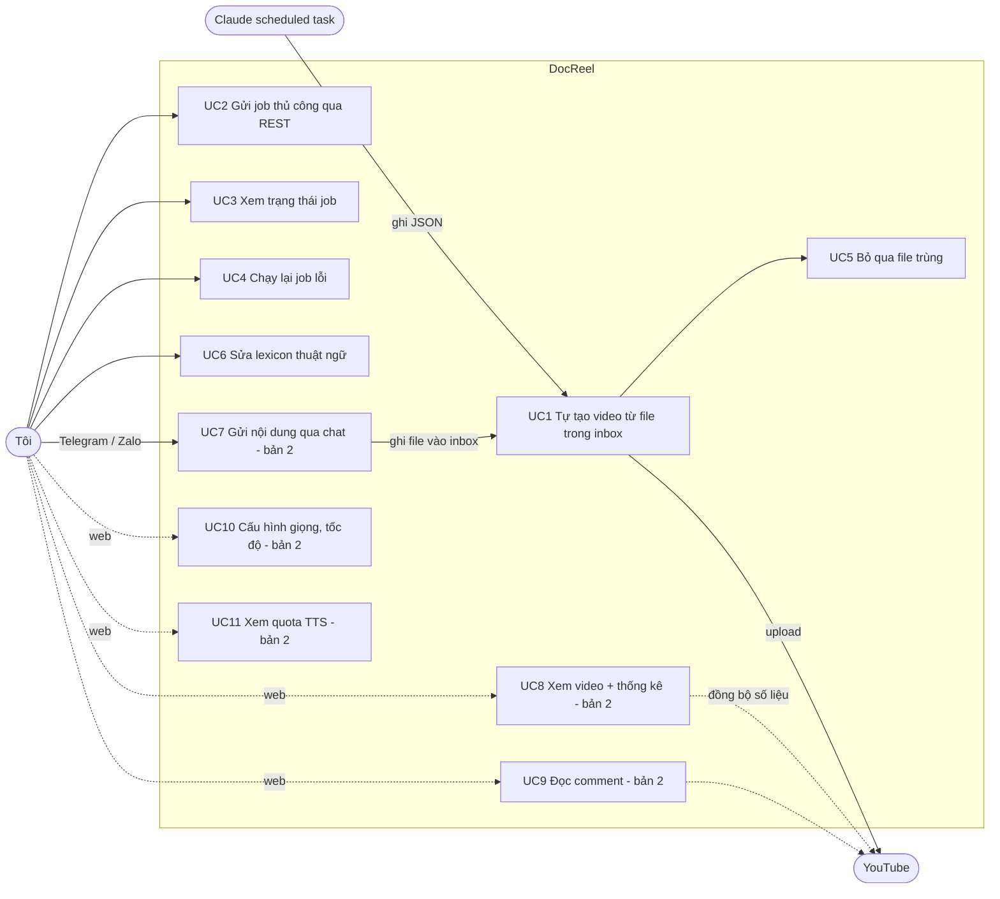
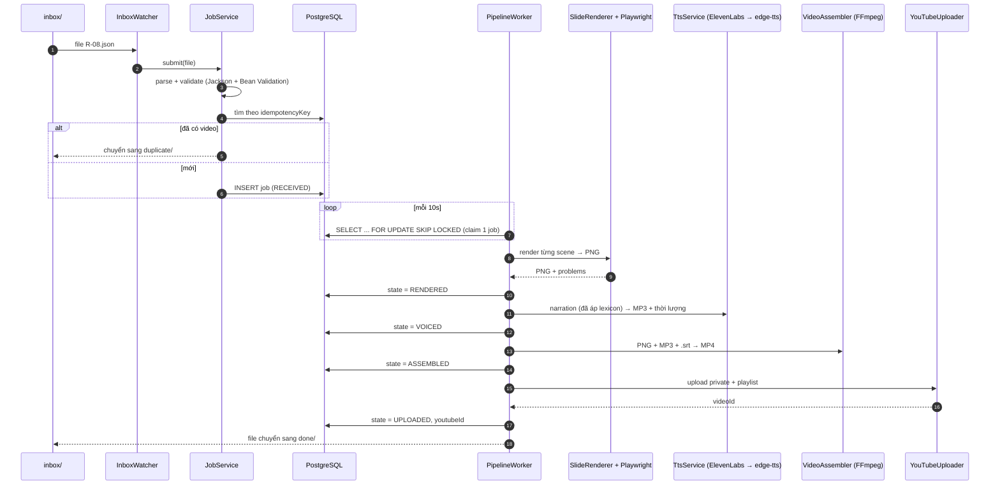
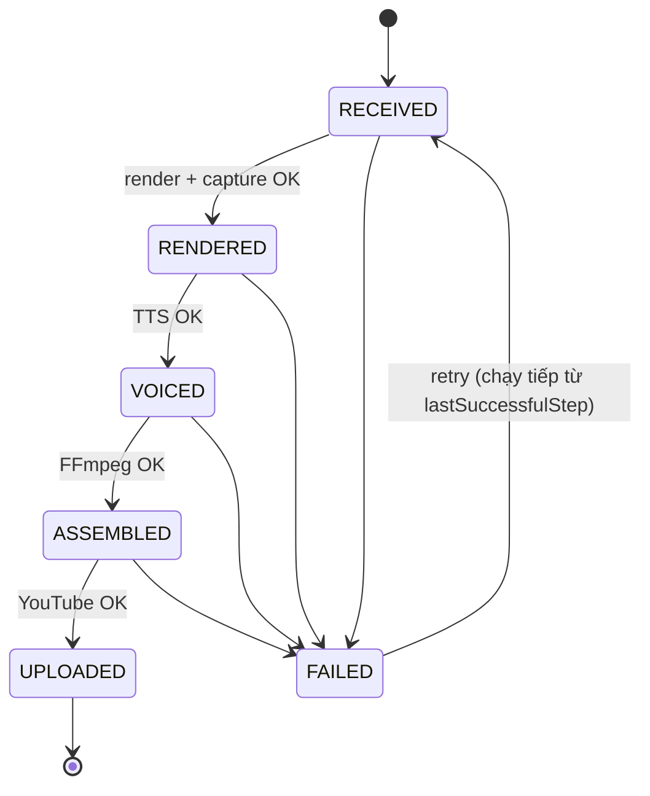
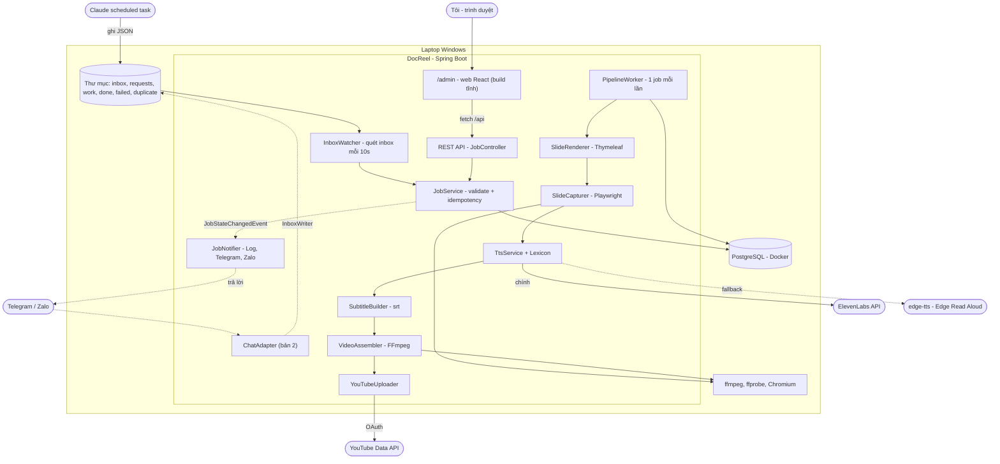
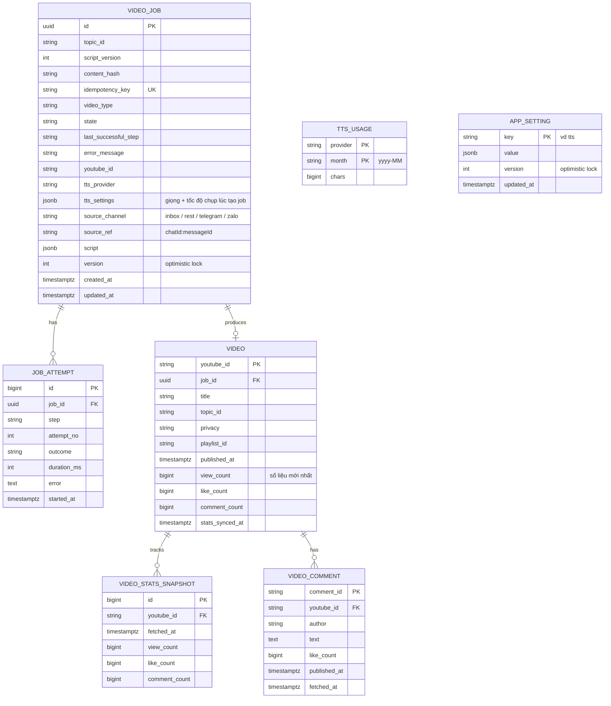
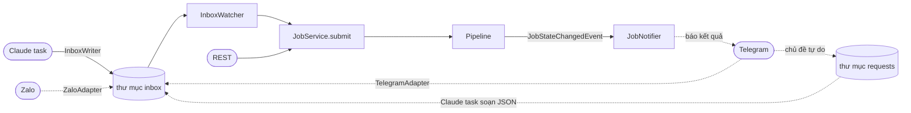

# DocReel — SPEC v1

> App Spring Boot chạy nền, nhận **file kịch bản JSON** rồi tự tạo **video Shorts tiếng Việt** (slide + giọng đọc + phụ đề) và upload lên YouTube ở chế độ private.
> Người dùng duy nhất: tôi. Mục đích: ôn bài trên xe buýt + luyện Java/Spring cho phỏng vấn ngân hàng.

---

## 1. Phạm vi

| Trong MVP | Bản 2 |
|---|---|
| Video **SLIDES**: ảnh tĩnh + zoom/fade bằng FFmpeg | Video **CHEATSHEET**: lưới thẻ có animation (chụp từng frame) |
| Input JSON thả vào `inbox/` hoặc gửi qua REST | **Trang quản trị** trong `web/` (mục 7.2): job + trạng thái, gửi JSON, **danh sách video** (link, view, like, comment), **cấu hình giọng đọc / tốc độ** (nghe thử), quota TTS |
| `web/` (React + TS): khung app + **Template preview** (dev) | |
| Cấu hình giọng/tốc độ là hằng số trong `application.yml` (đọc qua `TtsSettingsProvider`) | Sửa trên web, lưu DB, ghi đè `application.yml` |
| Quy ước ghi inbox + `origin` + `JobNotifier` (chuẩn bị sẵn cho kênh chat) | **Bot Telegram / Zalo**: gửi nội dung qua chat → tự tạo file inbox → chạy job → báo kết quả về chat |
| **10 template scene** tự tạo (chưa có sẵn) | Thêm template, theme sáng/tối |
| Giọng ElevenLabs (free) → hết quota tự **fallback edge-tts** (miễn phí, không key) + lexicon thuật ngữ | Nhạc nền, nhiều giọng đọc |
| Upload YouTube **private** + playlist | Public/unlisted (cần Google audit) |
| Chạy trên laptop (sau cùng: Windows service bằng WinSW) | Docker trên VPS |

**Không làm:** server gọi AI, agent kiểm duyệt, nhiều người dùng.
Phần AI soạn JSON nằm **ngoài** app (scheduled task của Claude ghi file vào `inbox/`).

---

## 2. Stack & quyết định kỹ thuật

| Hạng mục | Chọn | Lý do |
|---|---|---|
| Runtime | Java 21, Spring Boot 4.x (bản OSS mới nhất), Maven | Bản đang được hỗ trợ |
| DB | PostgreSQL 16 (Docker Compose) | Giống môi trường ngân hàng |
| Persistence | **JPA/Hibernate + Flyway**, `ddl-auto=validate` | JPA hay hỏi phỏng vấn; chỉ Flyway sửa schema |
| Worker | **Tuần tự 1 job/lần**, claim job bằng `FOR UPDATE SKIP LOCKED` | ~5 video/đêm là đủ; sẵn sàng scale |
| Render | Thymeleaf template 1080×1920 + `base.css`, `slide.js`, highlight.js | **Chưa có sẵn** → tự tạo 10 template (mục 7) |
| Chụp | Playwright Java, chờ `body[data-ready="1"]`, đọc `data-problems` | Kiểm lỗi bằng code, không dùng AI |
| Giọng chính | ElevenLabs API (gói Free), model `eleven_flash_v2_5` (có tiếng Việt) | Giọng tự nhiên nhất; free ~10k credit/tháng |
| Giọng dự phòng | **edge-tts** (Python CLI, giọng Neural `vi-VN` của Edge) qua `ProcessRunner` | Miễn phí, không cần tài khoản / key / thẻ; không chính thức nên có rủi ro hỏng tạm (mục 8) |
| Video | FFmpeg: `zoompan` + `xfade` + burn `.srt` | Đủ đẹp cho MVP |
| Upload | YouTube Data API v3, OAuth, `privacyStatus=private` | Project chưa audit sẽ bị ép private |
| Config | `application.yml` + biến môi trường / `.env` | Không gắn chặt với Windows |
| Web (preview + quản trị) | React 19 + **TypeScript** (strict) + Vite 8, react-router 8, CSS Modules, Vitest, ESLint | Dự án riêng `web/`; build ra `static/admin` để Spring phục vụ, không cần server thứ hai (mục 7.1) |

---

## 3. Use case



| UC | Mô tả | Kết quả |
|---|---|---|
| UC1 | File `*.json` xuất hiện trong `inbox/` → tạo job → chạy pipeline | Video private trên YouTube, file chuyển sang `done/` |
| UC2 | `POST /api/jobs` (body là JSON kịch bản) | Job mới, trả `jobId` |
| UC3 | `GET /api/jobs`, `GET /api/jobs/{id}` | Trạng thái, bước hiện tại, lỗi, link YouTube |
| UC4 | `POST /api/jobs/{id}/retry` | Chạy tiếp **từ bước lỗi**, không làm lại từ đầu |
| UC5 | Cùng `topicId + version + contentHash` đã UPLOADED | Không tạo job mới, file chuyển sang `duplicate/` |
| UC6 | Sửa `config/lexicon.yaml` (vd `JPA: "Giê Pi Ây"`) | Áp dụng cho các job sau |
| UC7 *(bản 2)* | Gửi JSON / chủ đề qua Telegram hoặc Zalo (mục 10) | Bot ghi file vào `inbox/` → UC1 chạy như thường; kết quả + link YouTube báo về đúng chat |
| UC8 *(bản 2)* | Trang **Videos**: danh sách video đã tạo | Tiêu đề, topic, link YouTube, privacy, ngày đăng, **view / like / comment** (đồng bộ định kỳ từ YouTube) |
| UC9 *(bản 2)* | Mở 1 video → xem comment | Danh sách comment (tác giả, nội dung, thời gian) lấy từ YouTube, có nút làm mới |
| UC10 *(bản 2)* | Trang **Cài đặt**: chọn giọng + tốc độ cho ElevenLabs và edge-tts, **nghe thử** trước khi lưu | Lưu DB; áp dụng cho **job tạo sau đó** (job đang chạy / retry giữ cấu hình cũ) |
| UC11 *(bản 2)* | Xem quota TTS tháng này | Ký tự đã dùng / còn lại của ElevenLabs; số ký tự đã đọc bằng edge-tts (không giới hạn) |
| UC3, UC4 qua web *(bản 2)* | Trang **Jobs**: danh sách, lọc trạng thái, chi tiết bước + attempt, nút Retry | Như UC3, UC4 nhưng trên giao diện |

---

## 4. Luồng chính (UC1)



---

## 5. Trạng thái job



- Mỗi bước **idempotent**: file trung gian lưu ở `work/{jobId}/`; bước nào đã có output hợp lệ thì bỏ qua.
- Retry tự động tối đa **2 lần/bước** (backoff 30s → 2 phút). Hết lượt thì FAILED và chờ retry tay.
- Validation sai (JSON lỗi, slide tràn chữ) → FAILED ngay, **không retry tự động**.

---

## 6. System design



**Package (theo feature):**
```
com.tuan.docreel
├── job/        VideoJob (entity), JobStep, JobRepository, JobService, JobController
├── pipeline/   PipelineWorker, Step (interface), StepContext, StepResult
├── script/     VideoScript, Scene (sealed interface + record theo type), ScriptValidator
├── render/     SlideRenderer, SlideCapturer
├── voice/      TtsService, TtsProvider (interface), ElevenLabsProvider, EdgeTtsProvider,
│               TtsUsageTracker, Lexicon, SubtitleBuilder
├── video/      VideoAssembler
├── youtube/    YouTubeUploader, OAuthTokenStore
├── ingest/     InboxWatcher, InboxWriter, ChatAdapter (interface), telegram/, zalo/ (bản 2)
├── notify/     JobStateChangedEvent, JobNotifier (interface), LogNotifier, TelegramNotifier (bản 2)
└── common/     ProcessRunner (ProcessBuilder + timeout + log), AppProperties
```

**Repo:**
```
doc-reel-2/
├── src/main/java/...            Spring Boot (package ở trên)
├── src/main/resources/          templates/, static/ (css, js, vendor), static/admin/ ← build của web/ (không commit)
├── samples/                     JSON mẫu (preview + test)
└── web/                         React + TypeScript (mục 7.1)
```

`Step` là interface chung (`supports(state)`, `execute(ctx)`), nên thêm bước hoặc thêm loại video CHEATSHEET không phải sửa `PipelineWorker`.

---

## 7. Template scene (tự tạo — 10 loại)

Chưa có template sẵn → AI gen **10 template** dùng chung 1 layout, 1 bộ CSS, 1 `slide.js`.
Mỗi scene trong JSON có `type` = 1 trong 10 loại dưới đây.

| # | `type` | Dùng khi | Nội dung | Giới hạn |
|---|---|---|---|---|
| 1 | `title` | Mở đầu video | chip track, tiêu đề (`accent` tô màu + `titleRest`), câu hook | tiêu đề ≤ 28, hook ≤ 60 ký tự |
| 2 | `points` | Liệt kê ý chính | 1–3 ý, mỗi ý có `heading` + `detail` | heading ≤ 24, detail ≤ 70 |
| 3 | `code` | Giải thích 1 đoạn code | file, ngôn ngữ, code, dòng highlight, `note` (info/warn/tip) | ≤ 8 dòng × 40 ký tự |
| 4 | `codeCompare` | Code sai → code đúng | 2 khối code xếp dọc (`bad` trên, `good` dưới) + note | mỗi khối ≤ 5 dòng × 40 |
| 5 | `compare` | So sánh A vs B / sai vs đúng | 2 cột, mỗi cột heading + items | ≤ 3 item/cột, item ≤ 30 |
| 6 | `definition` | Giới thiệu thuật ngữ | `term` cỡ lớn, `expansion` (viết tắt của gì), định nghĩa, ví dụ | term ≤ 20, định nghĩa ≤ 120, ví dụ ≤ 60 |
| 7 | `steps` | Quy trình / luồng xử lý | 3–5 bước đánh số, mũi tên dọc | mỗi bước ≤ 40 |
| 8 | `table` | So sánh nhiều tiêu chí | bảng 2–3 cột × tối đa 4 hàng | ô ≤ 18 |
| 9 | `quiz` | Câu hỏi phỏng vấn | câu hỏi + 2–4 lựa chọn; **2 frame**: hỏi → lộ đáp án + giải thích | hỏi ≤ 80, lựa chọn ≤ 30, giải thích ≤ 80 |
| 10 | `summary` | Kết video | bullets + câu `outro` | ≤ 4 bullet, mỗi bullet ≤ 40 |

> Prompt chi tiết để gen template: `TEMPLATE_PROMPT.md`. **Đã gen xong 10 template** (story 7).

**Phong cách:** infographic lập trình (thẻ, icon nét mảnh, từ khóa tiêu đề trong pill, nhãn code font mono) + chất vintage (nền xanh đậm, chữ kem, màu nhấn tông đất, viền 1–2px, bóng mềm, lưới mảnh, lớp nhiễu giấy opacity 0.05).

**Quy ước chung cho mọi template**
- Khung 1080×1920. **Vùng an toàn**: `.stage` nằm trong y = 220 → 1500 px, lề trái/phải 72 px; 420 px dưới cùng để trống cho phụ đề + UI của Shorts.
- Phần chung (`layout.html`, fragment `head` / `chrome` / `heading`): thanh tiến độ `scene i/n`, chip `track`, mã `topicId` mờ ở góc, tiêu đề chung (`accent` trong pill + `titleRest`, tối đa 2 dòng).
- Font **Be Vietnam Pro** (chữ), **JetBrains Mono** (code), **Fraunces** (tiêu đề lớn của `title`, `definition`), highlight.js 11.9 — tất cả **để local** trong `static/vendor/` (kèm giấy phép OFL/BSD), không gọi CDN.
- **Natural template Thymeleaf**: mở thẳng file `.html` vẫn thấy nội dung mẫu. Chỉ dùng `th:text`, `th:each`, `th:if`, `th:classappend`, `th:attr` (+ `th:href`/`th:src` cho link, `th:replace` cho fragment, `th:remove="all"` cho dòng mẫu tĩnh). **Không dùng `th:utext`** → mọi chữ trong JSON đều được escape.
- Model truyền vào template: `video` {topicId, track, title, theme}, `scene` (đúng object scene trong JSON), `index`, `total`, `frame` (chỉ `quiz`).
- `slide.js` (dùng chung):
  1. Vẽ thanh tiến độ từ `body[data-index]`, `body[data-total]`.
  2. Tô màu code bằng highlight.js, đánh số dòng, dòng trong `highlight[]` (đếm từ 1) có nền + vạch trái `--primary`.
  3. Chờ font → phần tử `[data-shrink]` (vd `term`, tiêu đề `title`) tự thu nhỏ chữ tới cỡ tối thiểu để vừa khung.
  4. Kiểm tràn: phần tử `[data-fit]` (mỗi loại chữ có số dòng tối đa riêng), số dòng code > `data-max-lines`, và `.stage` → ghi tên vào `body[data-problems]` (phân cách bởi dấu phẩy) → set `body[data-ready="1"]`.
- `quiz`: `body[data-frames="2"]`, frame 2 chỉ đổi CSS (đáp án đúng viền xanh, đáp án khác mờ, hiện giải thích) → **bố cục 2 frame không xê dịch**.
- Chưa có animation, nhưng mọi khối đã gắn `.anim-in` + `--order:n` cho bản sau.
- Màu theo `kind`: `bad` đỏ đất, `good` xanh xô thơm, `warn` vàng mù tạt, `info` xanh dương bạc, `tip` tím phấn.

**Theme:** mọi màu trong `base.css` lấy từ biến CSS. 10 theme trong `static/css/themes/` (mỗi file chỉ khai báo `--bg --card --primary --secondary --accent --text --muted`). Mặc định `midnight-brass`; JSON chọn qua trường `theme`.
`midnight-brass`, `petrol-sage`, `indigo-dust`, `navy-terracotta`, `slate-mustard`, `deep-ocean-coral`, `blueprint-cream`, `storm-rose`, `teal-navy-copper`, `prussian-olive`.

**Cấu trúc file**
```
src/main/resources/
├── templates/layout.html                fragment chung: head, chrome, heading
├── templates/scenes/{type}.html          10 file
├── static/css/base.css
├── static/css/themes/*.css               10 theme
├── static/js/slide.js
└── static/vendor/                        fonts/ (TTF + OFL), highlight/ (+ LICENSE)
samples/scenes/{type}.ok.json             1 mẫu hợp lệ / template      → phải 0 lỗi
samples/scenes/{type}.overflow.json       1 mẫu cố tình tràn / template → phải có lỗi
samples/full/sample-all-scenes.json       bài mẫu R-08 đủ 10 loại scene
samples/full/test-max-limits.json         mọi trường đúng bằng giới hạn tối đa + ký tự <>&"' → phải 0 lỗi
```

**Kết quả kiểm tra (Chromium headless, qua trang preview):** 10 mẫu `ok`, `sample-all-scenes.json`, `test-max-limits.json` → **0 lỗi**; 10 mẫu `overflow` → đều báo lỗi đúng chỗ.

### 7.1 Web `web/` — Template preview (dev) + trang quản trị (bản 2)

**Stack:** React 19, TypeScript (strict, `noUncheckedIndexedAccess`), Vite 8, react-router 8, CSS Modules (không thư viện UI), Vitest + jsdom, ESLint (typescript-eslint + react-hooks). Node ≥ 22.22.

```
cd web && npm install
npm run dev        → http://localhost:5173        (preview template)
npm test           → Vitest
npm run lint / npm run typecheck
npm run build      → src/main/resources/static/admin  → Spring phục vụ ở http://localhost:8080/admin/
```

**Cấu trúc**
```
web/
├── dev/docreelDevServer.ts     plugin Vite (chỉ dev): phục vụ /css /js /vendor /templates /samples giống Spring,
│                               GET /__dev/samples (danh sách mẫu), báo HMR "docreel:changed" khi file đổi
├── src/app/                    router, AppShell (thanh điều hướng), PageHeader
├── src/components/             UI dùng chung: Button, Select, Segmented, Toggle, Badge, Panel, Message, icon
├── src/domain/script.ts        kiểu TS của kịch bản JSON (mục 9.1) — dùng chung preview + quản trị
├── src/lib/thymeleaf/          render Thymeleaf trong trình duyệt + test
├── src/features/preview/       trang Template preview
├── src/features/jobs/          trang Jobs (bản 2, hiện là trang giữ chỗ)
└── vite.config.ts              alias @ → src, proxy /api + /actuator → :8080, build → static/admin
```

**Route**

| Route | Trang | Khi nào |
|---|---|---|
| `/preview` | Template preview | MVP, chỉ chạy ở `npm run dev` (bản build hiện thông báo) |
| `/jobs`, `/jobs/:id` | Danh sách / chi tiết job, trạng thái, retry | Bản 2 (UC3, UC4) |
| `/submit` | Gửi JSON thủ công + xem trước slide | Bản 2 (UC2) |
| `/videos`, `/videos/:id` | Danh sách video + link, view, like, comment; chi tiết + comment | Bản 2 (UC8, UC9) |
| `/settings` | Giọng đọc, tốc độ (nghe thử), quota TTS | Bản 2 (UC10, UC11) |

**Template preview**
- Render **chính file Thymeleaf thật** bằng `src/lib/thymeleaf` — chỉ hiểu đúng tập `th:*` được phép; dùng thuộc tính khác như `th:utext` → cảnh báo. Có test chạy cả 10 template với mẫu `ok`.
- **Lưới** (cả bài, badge OK / `tràn: …` lấy từ `body[data-problems]`) và **Từng slide** (phím ←/→, sửa JSON scene trực tiếp để thử giới hạn chữ, mở bản 1080×1920 ở tab mới).
- Chọn nguồn (10 mẫu `ok` / `overflow`, file trong `samples/full/`), đổi theme, bật lớp **vùng an toàn**.
- **Tự render lại** khi sửa template / CSS / `slide.js` / mẫu (HMR), không cần F5.
- Trạng thái nằm trên URL: `/preview?source=full:test-max-limits.json&theme=petrol-sage&view=single&slide=…&safe=1`.
- Mở thẳng natural template: `http://localhost:5173/templates/scenes/quiz.html?frame=2&theme=petrol-sage`.

**Trang quản trị (bản 2) — quy ước**
- Gọi REST `/api/**` (mục 11); dev qua proxy của Vite, prod cùng origin với Spring → không cần CORS.
- Kiểu dữ liệu đặt trong `src/domain/` (khớp record Java); mỗi trang là 1 thư mục trong `src/features/`.
- Spring phục vụ `static/admin/**` và **forward mọi route con `/admin/**` không phải file về `/admin/index.html`** (SPA fallback).
- Chưa có đăng nhập vì chỉ chạy trên laptop / mạng nội bộ; lên VPS thì thêm Basic Auth (Spring Security) cho `/admin/**` và `/api/**`.

**Còn lại khi có project Spring (story 8):** `GET /dev/preview/{type}?sample=ok|overflow&theme=&frame=` (profile `dev`) và test `TemplateGalleryTest` (render 10 mẫu `ok` → `data-problems` rỗng, 10 mẫu `overflow` → không rỗng, ghép `build/gallery/contact-sheet.png`). Validator kiểm `theme` thuộc danh sách 10 theme.

### 7.2 Trang quản trị (bản 2)

**Trang**

| Trang | Hiển thị / thao tác | API |
|---|---|---|
| **Jobs** `/jobs` | Bảng job: topic, tiêu đề, trạng thái (màu theo state), bước hiện tại, provider giọng, thời gian; lọc theo state; tự làm mới 10s | `GET /api/jobs` |
| **Chi tiết job** `/jobs/:id` | Dòng thời gian các bước + attempt (thời lượng, lỗi), slide PNG đã render, link YouTube; nút **Retry** khi FAILED | `GET /api/jobs/{id}`, `POST /api/jobs/{id}/retry` |
| **Gửi JSON** `/submit` | Dán / kéo file JSON → báo lỗi validate ngay → xem trước slide (dùng lại `features/preview`, HTML lấy từ server) → gửi | `POST /api/jobs/validate`, `POST /api/preview/slide`, `POST /api/jobs` |
| **Videos** `/videos` | Bảng video: thumbnail, tiêu đề, topic, privacy, ngày đăng, **view / like / comment**, link mở YouTube; sắp xếp theo view / ngày; thời điểm đồng bộ gần nhất | `GET /api/videos` |
| **Chi tiết video** `/videos/:id` | Số liệu + biểu đồ view theo thời gian (từ snapshot), **danh sách comment**, nút làm mới | `GET /api/videos/{id}`, `GET /api/videos/{id}/comments`, `POST /api/videos/{id}/refresh` |
| **Cài đặt** `/settings` | Giọng + tốc độ cho **ElevenLabs** và **edge-tts**, ô nhập câu → **Nghe thử** → Lưu; thẻ **quota TTS** tháng này | `GET/PUT /api/settings/tts`, `POST /api/tts/preview`, `GET /api/tts/usage` |

**Cấu hình giọng đọc (UC10)**
- Thứ tự ưu tiên: **DB (`app_setting`) → `application.yml`**. MVP chỉ đọc `application.yml` qua interface `TtsSettingsProvider`; bản 2 thêm `DbTtsSettingsProvider` mà không sửa `TtsService`.
- Được sửa: `elevenlabs.voiceId`, `elevenlabs.speed` (0.7–1.2), `edge.voice`, `edge.rate` (−50%…+50%), `primary` provider. **Không** sửa API key trên web (vẫn ở `.env`).
- Validate server-side: voice tồn tại (ElevenLabs `GET /v1/voices/{id}`, edge-tts: `--list-voices` có giọng đó), tốc độ trong khoảng.
- **Chụp cấu hình vào job khi tạo** (`video_job.tts_settings`): retry dùng đúng giọng cũ, video không bị đổi giọng giữa chừng; cache audio đã có `voice + speed` trong khóa.
- **Nghe thử**: câu ≤ 200 ký tự, **có tính vào quota** (ghi `tts_usage`), web hiện số ký tự sẽ tốn trước khi bấm.

**Số liệu video (UC8, UC9)**
- Bảng `video` tạo khi upload xong; `VideoStatsSyncJob` (`@Scheduled`) gọi YouTube Data API `videos.list?part=statistics,status` theo lô 50 video: video < 30 ngày mỗi 6 giờ, cũ hơn mỗi ngày → lưu `video_stats_snapshot` (để vẽ biểu đồ).
- Comment: `commentThreads.list` khi mở trang chi tiết hoặc bấm làm mới, cache vào `video_comment`, không đồng bộ nền.
- Quota YouTube 10.000 unit/ngày, mỗi lần đọc trên ≈ 1 unit → dư xa; vẫn ghi số unit đã dùng vào log.
- **Lưu ý:** video **private** chỉ mình tôi xem được → view / comment gần như bằng 0. Số liệu có ý nghĩa khi chuyển unlisted / public (cần Google audit, xem mục 1).

**Kiểu dữ liệu web:** thêm `src/domain/job.ts`, `video.ts`, `settings.ts` khớp DTO Java; mỗi trang một thư mục trong `src/features/` (`jobs/`, `submit/`, `videos/`, `settings/`).

---

## 8. Giọng đọc: ElevenLabs → fallback edge-tts

> **edge-tts** (thư viện Python) gọi dịch vụ "Read Aloud" của trình duyệt Microsoft Edge → dùng được các giọng Neural `vi-VN-HoaiMyNeural` / `vi-VN-NamMinhNeural` **miễn phí, không cần tài khoản hay key**.
> Đây là cách **không chính thức** (không SLA, Microsoft có thể đổi cơ chế làm hỏng tạm thời). Đủ cho dùng cá nhân ~5 video/đêm.

| | ElevenLabs (chính) | edge-tts (dự phòng) |
|---|---|---|
| Gói | Free: **10.000 credit/tháng**, không cộng dồn | **Miễn phí**, không tài khoản, không key, không quota công bố |
| Model / giọng | `eleven_flash_v2_5`, 1 `voiceId` | `vi-VN-HoaiMyNeural` (nữ) / `vi-VN-NamMinhNeural` (nam) |
| Ước tính (~1.000 ký tự / phút audio) | ~10–20 phút audio/tháng → **vài video đầu tháng** | Không giới hạn công bố → gánh phần còn lại |
| Cách gọi | REST API | CLI `edge-tts` (Python, `pip install edge-tts`) qua `ProcessRunner` |
| Rủi ro | Free chỉ dùng phi thương mại (video private → OK); có thể chặn API nếu thấy bất thường (VPN) | Không chính thức: có thể hỏng vài ngày khi Microsoft đổi xác thực (chờ `pip install -U edge-tts`); gọi dồn dập có thể bị chặn tạm → gọi tuần tự, nghỉ 300 ms giữa các câu |

> Quota ElevenLabs tính theo **ký tự** (kể cả dấu cách). Số liệu free tier có thể đổi — kiểm lại trang pricing trước khi chạy.
> **Đã chốt:** ưu tiên free → chấp nhận trong tháng có video giọng ElevenLabs, có video giọng edge-tts.
> Nếu sau này edge-tts hỏng lâu: thêm `AzureTtsProvider` (Azure AI Speech tier F0, cùng giọng, cần tài khoản Azure) mà không sửa `TtsService`.

**Quy tắc chọn provider (theo job, không theo scene)**
1. Áp lexicon → tính tổng ký tự `needed` của cả video.
2. Hỏi ElevenLabs `GET /v1/user/subscription` → `remaining = character_limit - character_count`.
3. `remaining ≥ needed × 1.1` → dùng ElevenLabs; ngược lại → edge-tts.
4. Đang đọc dở mà ElevenLabs trả `quota_exceeded` (401) / 429 → **bỏ hết audio của job đó, đọc lại toàn bộ bằng edge-tts** (1 video chỉ 1 giọng, không trộn).
5. Lỗi mạng / 5xx của ElevenLabs → retry bình thường của pipeline (mục 5), không chuyển provider.
6. edge-tts lỗi (CLI thoát ≠ 0, timeout, file rỗng) → retry theo pipeline (30s → 2 phút); vẫn lỗi → job FAILED với `TTS_UNAVAILABLE`, retry tay sau khi cập nhật `edge-tts`.
   Bảng `tts_usage(provider, month, chars)` cộng dồn mỗi lần gọi (edge-tts chỉ để thống kê; ElevenLabs dùng cho pre-check bước 2).

**Cách đọc + phụ đề (giống nhau cho cả 2 provider)**
- Tách narration thành từng câu → gọi TTS **từng câu** → `ffprobe` lấy thời lượng → nối thành audio của scene.
  ElevenLabs gửi kèm `previous_text`/`next_text` để ngữ điệu liền mạch; edge-tts: ghi câu ra file UTF-8 rồi `edge-tts --voice … --rate … --file câu.txt --write-media câu.mp3` (không truyền chữ qua tham số dòng lệnh → tránh lỗi codepage trên Windows).
- `.srt` dựng từ thời lượng từng câu → phụ đề khớp chính xác, không cần API căn thời gian.
- Cache audio theo `sha256(provider + voice + speed + câu)` trong `work/tts-cache/` → retry không tốn thêm quota.
- `job.tts_provider` lưu provider đã dùng; retry giữ nguyên provider (trừ trường hợp 4).

**Đồng bộ slide ↔ audio (độ dài theo nội dung)**
- **Không đặt trần cố định** cho độ dài video: video dài bằng tổng audio các scene.
- **Mỗi slide chiếu đúng bằng audio của scene đó** (vd slide "Vòng đời React" có audio 20s → slide chiếu 20s).
  `d_i = ffprobe(audio scene i)`; audio mỗi scene đã đệm sẵn 0,2s lặng đầu + 0,4s lặng cuối.
- Transition: clip ảnh scene i dài `d_i + T` (T = thời gian xfade, vd 0,3s; scene cuối dài `d_i`),
  offset xfade thứ k = `d_0 + … + d_(k-1)` → hình scene k bắt đầu đúng lúc audio scene k bắt đầu, xfade rơi vào đoạn lặng cuối nên không cắt lời.
- Audio các scene nối liền (`concat`), không crossfade.
- `quiz` có 2 frame: frame 1 chiếu bằng audio `narration`, frame 2 bằng audio `revealNarration`.
- `zoompan` tính số frame theo `d_i × fps`, không cố định.
- Tổng > 3 phút → YouTube không xếp vào Shorts; validator chỉ **cảnh báo**, vẫn chạy.

**Config (mỗi provider 1 bộ hằng số giọng + tốc độ, chốt sau khi nghe thử)**
```yaml
docreel.tts:
  primary: elevenlabs
  fallback: edge
  elevenlabs:
    api-key: ${ELEVENLABS_API_KEY}
    model: eleven_flash_v2_5
    voice-id: "TODO_CHON_SAU"       # lấy từ Voice Library
    speed: 1.0                      # voice_settings.speed, 0.7–1.2
  edge:
    command: edge-tts               # hoặc đường dẫn đầy đủ tới edge-tts(.exe)
    voice: vi-VN-HoaiMyNeural       # hoặc vi-VN-NamMinhNeural
    rate: "+0%"                     # --rate, vd "+10%"
    pause-between-calls-ms: 300
```
`TtsProvider` là interface (`remainingChars()`, `synthesize(sentence)`), nên đổi/thêm provider không phải sửa `TtsService`.

**Cài edge-tts (máy chạy app):** Python ≥ 3.9 → `pip install edge-tts` → kiểm `edge-tts --list-voices | findstr vi-VN`. `SystemSelfCheck` kiểm lệnh này lúc khởi động.

**Link nghe thử để chọn giọng + tốc độ (story 9)**
- ElevenLabs Voice Library (lọc Language = Vietnamese, copy `voiceId`): https://elevenlabs.io/app/voice-library
- ElevenLabs thử đọc + kéo thanh Speed: https://elevenlabs.io/app/speech-synthesis/text-to-speech
- edge-tts: nghe thử bằng lệnh (đổi `--rate` để thử tốc độ):
  `edge-tts --voice vi-VN-HoaiMyNeural --rate=+10% --text "JPA là chuẩn ánh xạ đối tượng" --write-media test.mp3`
- Mã nguồn + hướng dẫn edge-tts: https://github.com/rany2/edge-tts

---

## 9. Dữ liệu



- `idempotency_key = topicId:version:sha256(script)`, có **unique constraint** (chặn trùng kể cả khi 2 request cùng lúc → map ra 409).
- `@Version` trên `VideoJob` (optimistic locking).
- Bảng `APP_SETTING`, `VIDEO`, `VIDEO_STATS_SNAPSHOT`, `VIDEO_COMMENT` thuộc **bản 2** (Flyway migration riêng). MVP chỉ tạo `VIDEO_JOB`, `JOB_ATTEMPT`, `TTS_USAGE`; cột `tts_settings` có từ MVP (giá trị lấy từ `application.yml`).

### 9.1 Cấu trúc JSON kịch bản

Mẫu đầy đủ: `samples/full/sample-all-scenes.json` (bài R-08, đủ 10 loại scene). Mẫu biên: `samples/full/test-max-limits.json`.
Độ dài tính theo **ký tự** (code point, tiếng Việt có dấu tính 1 ký tự). ✱ = bắt buộc.

**Cấp video**

| Trường | Kiểu | Ràng buộc | Ghi chú |
|---|---|---|---|
| `topicId` ✱ | string | `^[A-Z]+-\d{2,}$`, vd `R-08` | cùng `version` + hash nội dung → khóa idempotency |
| `track` ✱ | string | ≤ 20 | hiện ở chip góc trên |
| `title` ✱ | string | ≤ 80 | tiêu đề video YouTube |
| `version` ✱ | int | ≥ 1 | tăng khi sửa nội dung để tạo video mới |
| `videoType` ✱ | enum | `SLIDES` (MVP), `CHEATSHEET` (bản 2) | |
| `theme` | enum | 1 trong 10 theme mục 7 | mặc định `midnight-brass` |
| `sources` | string[] | URL | ghi vào mô tả video |
| `scenes` ✱ | Scene[] | 4–10; đầu là `title`, cuối là `summary` | |
| `origin` | object | `{channel, chatId, messageId}` | mục 10; **không tính vào `contentHash`** |

**Trường chung của mọi scene**

| Trường | Kiểu | Ràng buộc | Ghi chú |
|---|---|---|---|
| `id` ✱ | string | duy nhất trong video, vd `s05-code` | đặt tên file `work/{jobId}/s05-code.png/.mp3` |
| `type` ✱ | enum | 10 loại mục 7 | Jackson `@JsonTypeInfo(property="type")` → `sealed interface Scene` + record mỗi loại |
| `narration` ✱ | string | 1+ câu | lời đọc + phụ đề |
| `spoken` | string | | thay `narration` **khi đọc** (phụ đề vẫn dùng `narration`), vd `"use"` → `"diu"` |
| `accent` | string | | phần tiêu đề trong pill (các type có tiêu đề chung) |
| `titleRest` | string | `accent` + `titleRest` ≤ 28 | phần còn lại của tiêu đề |

**Trường riêng theo `type`**

| `type` | Trường (✱ bắt buộc) | Ràng buộc |
|---|---|---|
| `title` | `chip`, `accent`✱, `titleRest`, `hook`✱ | chip ≤ 24, hook ≤ 60 |
| `definition` | `term`✱, `expansion`, `definition`✱, `example` | term ≤ 20, expansion ≤ 40, definition ≤ 120, example ≤ 60 (không có tiêu đề chung) |
| `points` | `accent`✱, `titleRest`, `points`✱ [{`heading`✱, `detail`✱}] | 1–3 ý; heading ≤ 24, detail ≤ 70 |
| `steps` | `accent`✱, `titleRest`, `steps`✱ string[] | 3–5 bước, mỗi bước ≤ 40 |
| `code` | `accent`✱, `titleRest`, `file`, `lang`✱, `code`✱, `highlight` int[], `note`, `noteKind` | code ≤ 8 dòng × 40; `highlight` đếm từ 1; `noteKind` = `info` (mặc định) \| `warn` \| `tip`; note ≤ 70 |
| `codeCompare` | `accent`✱, `titleRest`, `lang`✱, `bad`✱ {`label`✱, `code`✱}, `good`✱ {`label`✱, `code`✱}, `note` | mỗi khối ≤ 5 dòng × 40; label ≤ 24; note ≤ 70 |
| `compare` | `accent`✱, `titleRest`, `left`✱ / `right`✱ {`heading`✱, `kind`, `items`✱ string[]}, `note` | `kind` = `neutral` (mặc định) \| `bad` \| `good`; heading ≤ 16; ≤ 3 item/cột, item ≤ 30; note ≤ 70 |
| `table` | `accent`✱, `titleRest`, `columns`✱ string[], `rows`✱ string[][] | 2–3 cột × 1–4 hàng; mỗi hàng đúng số cột; ô ≤ 18 |
| `quiz` | `question`✱, `options`✱ string[], `answer`✱ int, `explain`✱, `revealNarration`✱ | 2–4 lựa chọn; `answer` là **index từ 0**; question ≤ 80, option ≤ 30, explain ≤ 80. `narration` đọc ở frame 1, `revealNarration` ở frame 2 (không có tiêu đề chung) |
| `summary` | `accent`✱, `titleRest`, `bullets`✱ string[], `outro` | 1–4 bullet, mỗi bullet ≤ 40; outro ≤ 70 |

**Ví dụ (rút gọn từ `sample-all-scenes.json`)**
```json
{
  "topicId": "R-08",
  "track": "React",
  "title": "Rules of Hooks & useReducer",
  "version": 1,
  "videoType": "SLIDES",
  "theme": "midnight-brass",
  "sources": ["https://react.dev/reference/rules/rules-of-hooks"],
  "scenes": [
    { "id": "s01-title", "type": "title", "chip": "Ôn bài 60 giây", "accent": "Rules", "titleRest": "of Hooks",
      "hook": "Vì sao Hook không được nằm trong if?", "narration": "..." },
    { "id": "s02-definition", "type": "definition", "term": "Hook", "expansion": "use* function",
      "definition": "Hàm bắt đầu bằng use, cho component dùng state ...", "example": "const [n, setN] = useState(0)",
      "narration": "Hook là các hàm bắt đầu bằng chữ use ...", "spoken": "Hook là các hàm bắt đầu bằng chữ diu ..." },
    { "id": "s03-points", "type": "points", "accent": "2 luật", "titleRest": "của Hooks",
      "points": [{ "heading": "Chỉ gọi ở top level", "detail": "Không đặt trong if, vòng lặp hay sau return sớm" }],
      "narration": "..." },
    { "id": "s04-steps", "type": "steps", "accent": "React", "titleRest": "nhớ Hook thế nào?",
      "steps": ["Render 1: gọi Hook theo thứ tự 0, 1, 2", "React lưu state vào ô 0, 1, 2", "Mỗi Hook lấy đúng ô của mình"],
      "narration": "..." },
    { "id": "s05-code", "type": "code", "accent": "Return sớm", "titleRest": "trước Hook", "file": "Profile.tsx", "lang": "tsx",
      "code": "function Profile({ user }) {\n  if (!user) return null;\n  ...", "highlight": [2, 3],
      "note": "Lần đầu 0 Hook, lần sau 1 Hook: React báo lỗi", "noteKind": "warn", "narration": "..." },
    { "id": "s06-code-compare", "type": "codeCompare", "accent": "Sửa", "titleRest": "thế nào?", "lang": "tsx",
      "bad":  { "label": "Hook trong if", "code": "if (open) {\n  useEffect(() => sub(), []);\n}" },
      "good": { "label": "Điều kiện trong Hook", "code": "useEffect(() => {\n  if (open) sub();\n}, [open]);" },
      "note": "Đưa điều kiện vào bên trong Hook", "narration": "..." },
    { "id": "s07-compare", "type": "compare", "accent": "useState", "titleRest": "hay useReducer?",
      "left":  { "heading": "useState",   "kind": "neutral", "items": ["State đơn lẻ, độc lập"] },
      "right": { "heading": "useReducer", "kind": "good",    "items": ["Nhiều state đổi cùng lúc"] },
      "note": "Hiệu năng như nhau, khác ở cách tổ chức logic", "narration": "..." },
    { "id": "s08-table", "type": "table", "accent": "So sánh", "titleRest": "nhanh",
      "columns": ["Tiêu chí", "useState", "useReducer"], "rows": [["Độ phức tạp", "Thấp", "Trung bình"]], "narration": "..." },
    { "id": "s09-quiz", "type": "quiz", "question": "Vì sao Hook phải được gọi cùng thứ tự ở mọi lần render?",
      "options": ["Để code dễ đọc hơn", "React lưu state theo thứ tự", "Để chạy nhanh hơn", "Do TypeScript yêu cầu"],
      "answer": 1, "explain": "React gắn state vào từng Hook theo thứ tự gọi, không theo tên biến.",
      "narration": "Câu hỏi phỏng vấn: ...", "revealNarration": "Đáp án B. ..." },
    { "id": "s10-summary", "type": "summary", "accent": "Chốt", "titleRest": "trong 10 giây",
      "bullets": ["Hook luôn ở top level", "Bật eslint-plugin-react-hooks"],
      "outro": "Vì sao Hook phải gọi cùng thứ tự?", "narration": "..." }
  ]
}
```

**Quy tắc validate**
- Bean Validation trên record (`@NotBlank`, `@Size`, `@Pattern`) + `ScriptValidator` cho ràng buộc chéo: scene đầu/cuối, `id` không trùng, số dòng/độ dài dòng code, `answer < options.size()`, mỗi hàng `table` đúng số cột, `highlight` nằm trong số dòng code, `theme` thuộc danh sách.
- Validator chặn trước **theo số ký tự**; `slide.js` chặn sau **theo hình hiển thị thực** (`data-problems`). Một trong hai sai → job FAILED, không retry tự động.
- **Không giới hạn tổng thời lượng** (mỗi slide dài bằng audio của nó, mục 8; > 3 phút chỉ cảnh báo). Lexicon áp cho mọi `narration` / `spoken` / `revealNarration`.
- Trường lạ → lỗi (`FAIL_ON_UNKNOWN_PROPERTIES`) để bắt lỗi gõ tên trường từ AI.

**Trong `samples/scenes/*.json`** (chỉ dùng cho preview/test template): `{ "video": {topicId, track, title, theme}, "scene": {...} }`.

---

## 10. Kênh nhận nội dung (inbox là cổng chung)

**Nguyên tắc:** kênh bất đồng bộ (Claude task, Telegram, Zalo, sau này email…) **chỉ làm 1 việc: ghi file JSON vào `inbox/`**.
`InboxWatcher` lo phần còn lại → thêm kênh mới **không phải sửa** `JobService` hay pipeline.
REST vẫn gọi thẳng `JobService.submit(script, origin)` vì cần trả `jobId`/409 ngay; InboxWatcher cũng gọi đúng hàm này.



| Kênh | Khi nào | Cách nhận | Ghi chú |
|---|---|---|---|
| Thư mục `inbox/` (Claude task, copy tay) | MVP | `InboxWatcher` quét mỗi 10s | |
| REST `POST /api/jobs` | MVP | gọi thẳng `JobService` | |
| Telegram bot | Bản 2 (làm trước) | **long polling** `getUpdates` → chạy trên laptop, không cần IP public; lên VPS có thể đổi sang webhook | Dễ nhất, API ổn định |
| Zalo bot | Bản 2 | Zalo Bot / Zalo OA API (kiểm điều kiện đăng ký + kiểu nhận tin lúc làm; nếu chỉ có webhook thì làm khi đã có VPS + HTTPS) | Làm sau Telegram |

**Quy ước ghi file vào inbox (áp dụng ngay từ MVP)**
- Mọi nơi ghi file đều qua `InboxWriter` (Claude task cũng theo đúng quy ước này).
- Tên file: `{channel}-{yyyyMMdd'T'HHmmss}-{ref}.json`, vd `telegram-20261123T213000-5521.json`.
- **Ghi nguyên tử**: ghi `*.json.part` → `Files.move(..., ATOMIC_MOVE)` sang `*.json`. `InboxWatcher` chỉ đọc `*.json` → không bao giờ đọc file ghi dở.
- Gắn `origin` vào JSON để biết báo kết quả về đâu.

**Bot xử lý tin nhắn thế nào (bản 2)**
| Tôi gửi | Bot làm |
|---|---|
| File `.json` đính kèm, hoặc tin nhắn là JSON | Validate ngay bằng `ScriptValidator` → sai: trả lỗi trong chat; đúng: `InboxWriter` ghi vào `inbox/` |
| Chủ đề / ghi chú tự do, vd `/topic Spring @Transactional` | App **không gọi AI** → ghi `requests/{...}.md` (kèm `origin`); Claude scheduled task đọc `requests/`, soạn JSON, ghi vào `inbox/` |
| `/jobs`, `/status <id>`, `/retry <id>` | Gọi `JobService` như REST |

**Báo kết quả về chat**
- `JobService` / `PipelineWorker` publish `JobStateChangedEvent`; listener dùng `@TransactionalEventListener(AFTER_COMMIT)` → chỉ báo khi DB đã commit.
- `JobNotifier` là interface. MVP chỉ có `LogNotifier`; bản 2 thêm `TelegramNotifier`, `ZaloNotifier`, chọn theo `job.source_channel`.
- Nội dung báo: đã nhận job / lỗi validation / FAILED ở bước nào + lỗi / UPLOADED + link YouTube.

**Bảo mật**
- Token bot để trong `.env`.
- Whitelist `allowed-chat-ids` (chỉ tôi); tin từ chat khác bỏ qua + ghi log.
- Chỉ nhận text hoặc `.json` ≤ 1 MB.

```yaml
docreel.channels:
  telegram: { enabled: false, bot-token: ${TELEGRAM_BOT_TOKEN}, allowed-chat-ids: [] }
  zalo:     { enabled: false, bot-token: ${ZALO_BOT_TOKEN},     allowed-chat-ids: [] }
```
Adapter bật/tắt bằng `@ConditionalOnProperty(...enabled)` → tắt thì bean không được tạo, app vẫn chạy bình thường.

---

## 11. REST API

| Method | Path | Mô tả | Mã trả |
|---|---|---|---|
| POST | `/api/jobs` | Gửi JSON kịch bản | 201 + `jobId`; 400 sai schema; 409 trùng |
| GET | `/api/jobs?state=FAILED` | Danh sách job | 200 |
| GET | `/api/jobs/{id}` | Chi tiết + các attempt | 200 / 404 |
| POST | `/api/jobs/{id}/retry` | Chạy lại job FAILED | 202; 409 nếu job không ở FAILED |
| GET | `/actuator/health` | Health check | 200 |
| GET | `/admin/**` | Web quản trị (build của `web/`), route con fallback về `index.html` | 200 |

**Bản 2 — cho trang quản trị (mục 7.2)**

| Method | Path | Mô tả | Mã trả |
|---|---|---|---|
| POST | `/api/jobs/validate` | Chỉ validate JSON, không tạo job | 200 + danh sách lỗi theo trường |
| POST | `/api/preview/slide` | `{video, scene, index, total, frame}` → HTML do Thymeleaf thật render (xem trước ở trang Gửi JSON) | 200 `text/html`; 400 |
| GET | `/api/videos?sort=views\|published&page=` | Danh sách video + số liệu mới nhất | 200 |
| GET | `/api/videos/{youtubeId}` | Chi tiết + snapshot số liệu theo thời gian | 200 / 404 |
| GET | `/api/videos/{youtubeId}/comments` | Comment (cache; `?refresh=true` gọi YouTube) | 200 |
| POST | `/api/videos/{youtubeId}/refresh` | Đồng bộ số liệu ngay | 202 |
| GET | `/api/settings/tts` | Cấu hình giọng hiện tại (DB → yml) | 200 |
| PUT | `/api/settings/tts` | Lưu cấu hình (có `version`, chống ghi đè) | 200; 400 sai giá trị; 409 version cũ |
| POST | `/api/tts/preview` | Đọc thử 1 câu ≤ 200 ký tự → `audio/mpeg` | 200; 400; 429 hết quota |
| GET | `/api/tts/usage?month=` | Ký tự đã dùng / giới hạn theo provider | 200 |
| GET | `/api/system/check` | Kết quả tự kiểm tra lúc chạy (mục 12.1) | 200 |

Lỗi trả theo format chung (`@RestControllerAdvice` + `ProblemDetail`) — web hiển thị `title` + `detail` của ProblemDetail.

---

## 12. Stories (theo thứ tự)

> **Kế hoạch code chi tiết theo phase / use case, kèm unit test và lệnh tự kiểm tra: `PLAN.md`.** Bảng dưới là danh sách story gốc; cột cuối của PLAN ghi phase nào làm story nào.

| # | Story | Ai viết | Done khi |
|---|---|---|---|
| 1 | Khung project: Boot 4, Postgres Compose, Flyway V1, Actuator | AI | `docker compose up` + app chạy, health 200 |
| 2 | `VideoScript` + Scene record + validation | **Tôi** | Test: JSON mẫu hợp lệ / 5 case lỗi |
| 3 | `VideoJob` entity + state machine + idempotency | **Tôi** | Test: chuyển trạng thái sai → exception; trùng key → 409 |
| 4 | REST API (POST/GET/retry) + ProblemDetail | **Tôi** | Test MockMvc cho từng mã trả |
| 5 | InboxWatcher + `InboxWriter` (ghi nguyên tử `.part` → `.json`) + đọc `origin` + di chuyển file | AI | Thả file → có job; file lỗi → `failed/`; file `.part` không bị đọc |
| 6 | PipelineWorker + claim `SKIP LOCKED` + retry + `JobStateChangedEvent` → `LogNotifier` | **Tôi** | Test: 2 worker không lấy trùng job (Testcontainers); mỗi lần đổi state có 1 event sau commit |
| 7 | ✅ **Gen 10 template** + `layout.html`, `base.css`, 10 theme, `slide.js`, font local (mục 7) | AI | Preview: mẫu `ok` + `test-max-limits` 0 lỗi, mẫu `overflow` đều báo lỗi; tôi duyệt bằng mắt |
| 7b | ✅ Dự án `web/` (React + TS + Vite): khung app, router, UI dùng chung, **Template preview**, test bộ render (mục 7.1) | AI | `npm test`, `lint`, `typecheck`, `build` đều qua; preview cho kết quả như story 7 |
| 8 | SlideRenderer + SlideCapturer (gồm `quiz` 2 frame) + `/dev/preview/{type}` + `TemplateGalleryTest` | AI | 10 template ra PNG; mẫu `overflow` → FAILED; `build/gallery/contact-sheet.png` |
| 9 | **Spike:** nghe thử giọng ElevenLabs + edge-tts `vi-VN` đọc thuật ngữ (link ở mục 8) | Tôi | Điền `voice-id`/`speed` ElevenLabs, `voice`/`rate` edge-tts vào config + 20 mục lexicon đầu |
| 10 | `TtsProvider` ×2 + chọn/fallback provider + `tts_usage` + cache | AI | Test: hết quota ElevenLabs (mock 401) → cả job đọc bằng edge-tts; edge-tts lỗi (CLI giả thoát ≠ 0) → retry rồi `TTS_UNAVAILABLE` |
| 11 | Lexicon + SubtitleBuilder | AI | Audio từng scene + `.srt` khớp thời lượng |
| 12 | VideoAssembler (zoompan + xfade + subtitle), thời lượng slide = audio scene | AI | MP4 dọc phát được; đầu mỗi slide lệch đầu audio scene ≤ 1 frame |
| 13 | YouTubeUploader (OAuth, private, playlist) | AI | Video thấy được trên điện thoại |
| 14 | Chạy end-to-end 3 file (1 file lỗi) | Tôi | 2 video, 1 FAILED, không ảnh hưởng nhau |
| 15 | WinSW service + log ra file | AI | Restart máy, app tự chạy |

**Backlog bản 2 — kênh chat (mục 10)**
| # | Story | Done khi |
|---|---|---|
| B1 | `TelegramAdapter` (long polling, whitelist, nhận JSON → `InboxWriter`) | Gửi file JSON qua Telegram → có video private |
| B2 | `TelegramNotifier` | Nhận tin báo: đã nhận / lỗi / link YouTube trong đúng chat |
| B3 | Lệnh `/topic` → `requests/` + Claude task soạn JSON | Gửi 1 câu chủ đề → có video |
| B4 | `ZaloAdapter` + `ZaloNotifier` | Như B1–B2 nhưng qua Zalo |

**Backlog bản 2 — trang quản trị `web/` (mục 7.2)**
| # | Story | Done khi |
|---|---|---|
| W1 | Spring phục vụ `/admin/**` + SPA fallback; Maven build chạy `npm ci && npm run build` (frontend-maven-plugin) | `mvn package` → jar có sẵn web; mở `/admin/jobs` trực tiếp không 404 |
| W2 | Trang **Jobs** + **chi tiết job** + Retry (UC3, UC4) | Thấy job mới trong ≤ 10s; Retry job FAILED → chạy tiếp từ bước lỗi |
| W3 | Trang **Gửi JSON** + `POST /api/jobs/validate` (UC2) | Lỗi validate hiện đúng trường; 409 hiện rõ |
| W4 | **Cài đặt giọng / tốc độ** + nghe thử + `DbTtsSettingsProvider` (UC10) | Đổi giọng → job **sau đó** dùng giọng mới, job cũ retry vẫn giọng cũ |
| W5 | Thẻ **quota TTS** (UC11) | Số khớp bảng `tts_usage` |
| W6 | Bảng `video` + **đồng bộ số liệu** YouTube + trang **Videos** (UC8) | View/like/comment khớp YouTube Studio (sai lệch do độ trễ YouTube) |
| W7 | **Comment** của video (UC9) | Comment mới hiện sau khi bấm làm mới |
| W8 | Basic Auth cho `/admin/**` + `/api/**` khi lên VPS | Không đăng nhập → 401 |

### 12.1 Kiểm thử & tự kiểm tra

Chi tiết từng phase ở `PLAN.md`. Tóm tắt 6 lớp:

| Lớp | Công cụ | Chạy khi |
|---|---|---|
| 1. Tĩnh | Compile `-Werror`, Spotless, **ArchUnit** (luật phụ thuộc giữa package), ESLint + `tsc` cho `web/` | Mỗi lần build |
| 2. Unit | JUnit 5 + AssertJ + Mockito; Vitest. **JaCoCo ≥ 80%** dòng cho `script`, `job`, `pipeline`, `voice` | `./mvnw test`, `npm test` |
| 3. Integration | Testcontainers (Postgres), MockMvc, **WireMock** giả ElevenLabs / YouTube; script giả thay CLI edge-tts | `./mvnw verify` |
| 4. Contract | Cùng bộ `samples/` (hợp lệ + `samples/invalid/`) chạy qua validator Java **và** TS → kết quả phải giống nhau | `./mvnw verify`, `npm test` |
| 5. E2E | Profile `e2e`: TTS giả (âm thanh đúng độ dài) + YouTube giả → chạy `sample-all-scenes.json` → kiểm MP4 bằng `ffprobe` (thời lượng, mốc slide) | `./mvnw verify -Pe2e` |
| 6. Lúc chạy | `SystemSelfCheck` lúc khởi động + Actuator health: ffmpeg/ffprobe, Chromium, thư mục ghi được, ổ trống, DB, key TTS, token YouTube. Lỗi nghiêm trọng → **tạm dừng worker**, không nhận job mới | Khởi động app; `GET /actuator/health`, `GET /api/system/check`; `java -jar docreel.jar --doctor` |

Một lệnh kiểm tra tất cả: `scripts/check.ps1` (Windows) / `scripts/check.sh` → lớp 1–4 (+5 nếu có `-E2E`). Git hook `pre-push` gọi lệnh này.

---

## 13. Tiêu chí hoàn thành MVP
- Thả 1 JSON hợp lệ → video private trên YouTube, không thao tác tay.
- Thả 3 file → 1 lỗi không làm hỏng 2 file còn lại.
- Thả lại cùng file → không upload trùng.
- Mỗi job có log theo `jobId` và lịch sử attempt trong DB.
- Hết quota ElevenLabs → video vẫn ra bằng giọng edge-tts, không thao tác tay; không phát sinh chi phí TTS.
- Mỗi slide chiếu đúng bằng audio của scene đó.

## 14. Quyết định đã chốt
- Độ dài video theo nội dung; slide và audio của từng scene đi cùng nhau (mục 8).
- Ưu tiên free: chấp nhận video trong tháng khác giọng (ElevenLabs trước, edge-tts sau).
- Giọng + tốc độ: để hằng số trong config cho từng provider, chọn sau khi nghe thử (story 9).
- Dựng và chạy ổn trên laptop trước, xong mới thuê VPS.
- Kênh chat (Telegram/Zalo) chỉ ghi file vào `inbox/`; MVP làm sẵn `InboxWriter`, `origin`, `JobNotifier` để bản 2 cắm vào không sửa core (mục 10).
- Web là dự án React + TypeScript riêng trong `web/`, build tĩnh vào `static/admin` để Spring phục vụ (một process, một port, không CORS); preview template và trang quản trị dùng chung app (mục 7.1).
- Bản 2 của web: jobs + trạng thái, gửi JSON, danh sách video + view/like/comment, cấu hình giọng/tốc độ (lưu DB, ghi đè yml, chụp vào job khi tạo), quota TTS (mục 7.2). MVP chuẩn bị sẵn `TtsSettingsProvider` và cột `tts_settings`.

## 15. Câu hỏi còn mở
- Giọng văn kịch bản (xưng hô, mức trang trọng, có câu hook/CTA cố định không).
- Có định chuyển video sang unlisted / public không? Video private gần như không có view / comment, nên trang Videos (UC8, UC9) chỉ có ý nghĩa khi qua được Google audit.
